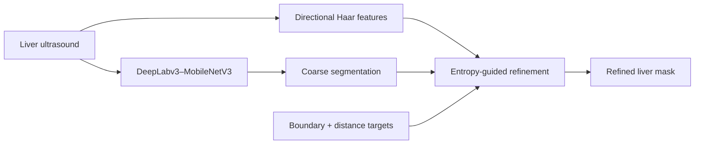

<div align="center">

# DeepLabNet for Liver Ultrasound Segmentation

### Haar-frequency fusion, entropy-guided refinement, and boundary supervision

[](https://github.com/pkhunter47)
[](https://pytorch.org/vision/stable/models/deeplabv3.html)

</div>

## Overview

**DeepLabNet** is a lightweight liver-ultrasound segmentation framework designed for speckle noise, uncertain boundaries, acoustic shadow, and intensity variation. It extends DeepLabv3 with a MobileNetV3-Large backbone using frequency, uncertainty, and geometric supervision.

## Method



The complete objective combines segmentation, boundary, signed-distance, and—within DeepLabNet-R—appearance-consistency losses.

## Dataset protocol

- 732 valid liver-ultrasound images
- 512 training, 110 validation, and 110 test images
- Stratified, duplicate-group-disjoint partitioning
- Binary liver masks generated from polygon annotations

## Reported results

| Measure | DeepLabNet |
|---|---:|
| Dice | **0.8641** |
| IoU | **0.7707** |
| Dice gain over baseline | **+0.0102** |
| IoU gain over baseline | **+0.0140** |
| Parameters | **11.023M** |
| GMACs | **6.003** |
| Additional parameters | **2,954** |

The Dice and IoU improvements over the reference model remained significant after Holm correction. Regional predictive entropy correlated with segmentation error at Spearman's rho **0.7031**.

## Robustness findings

DeepLabNet-R improved resistance to severe speckle noise and reduced gain, but produced limited benefit under acoustic shadowing. These mixed results are retained because robustness claims should reflect both strengths and failure cases.

## Release status

The uploaded package contained the manuscript and figures, but not the original experiment code. This repository therefore includes a **manuscript-derived reference implementation** of the described architecture and losses. It is suitable for inspection and new experiments, but it is not claimed to reproduce the reported numbers until it is run with the original data, split manifest, preprocessing, and hyperparameters.

## Repository contents

```text
deeplabnet-liver-ultrasound/
├── src/deeplabnet/model.py   # Reference architecture
├── train.py                  # Paired image/mask training runner
├── requirements.txt
├── docs/CODE_STATUS.md
└── README.md
```

## Quick start

Arrange data as `data/train/images`, `data/train/masks`, `data/val/images`, and `data/val/masks`, using matching file stems. Then run:

```bash
python -m venv .venv
source .venv/bin/activate
pip install -r requirements.txt
python train.py --data-root data --epochs 50 --output checkpoints/deeplabnet.pt
```

## Limitations

- Small, single-center dataset
- Patient identifiers unavailable for patient-disjoint evaluation
- No compatible external segmentation masks for quantitative validation
- Limited improvement under acoustic shadow
- Clinical use requires larger multi-center testing

## Responsible-use notice

DeepLabNet is a research prototype and is not approved for clinical diagnosis or treatment planning.

## Contact

**Protik Biswas** · [GitHub](https://github.com/pkhunter47) · [LinkedIn](https://www.linkedin.com/in/protik-biswas-83001827b/) · [Email](mailto:protikbiswas3099@gmail.com)
